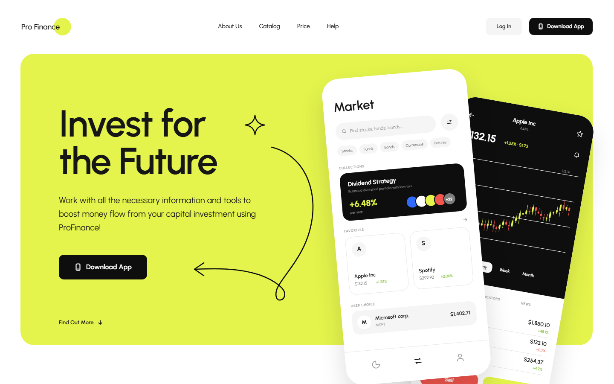
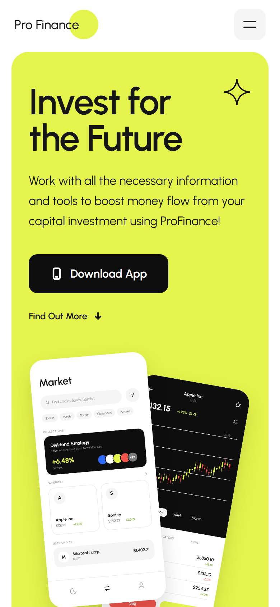
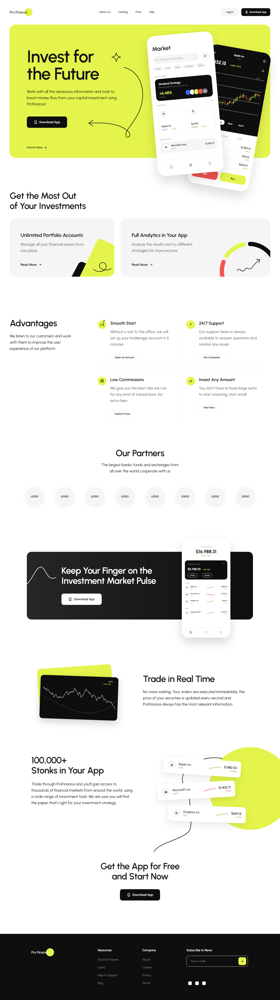

# Pro Finance — Animated Fintech Landing Page

A pixel-perfect, fully animated landing page for a fictional investment app, built from a Figma design with **vanilla HTML, CSS and JavaScript** and **GSAP**. No frameworks and no build step: the whole page loads straight from three files.

<!-- Replace with your deployed URL (e.g. GitHub Pages) -->
**[Live demo →](https://pro-finance-site.vercel.app/)**



<details>
<summary><strong>View mobile version</strong></summary>



</details>

<details>
<summary><strong>View full page</strong></summary>



</details>

---

## Overview

This project turns a 1440px Figma desktop design into a production-quality, fully responsive web page. I focused on four things:

- **Design fidelity:** every spacing value, font size, colour token, rotation and shadow comes straight from the Figma file. All illustrations and icons are the original SVG exports, not redrawn.
- **Responsive design:** the desktop composition is kept 1:1, and small screens get their own fluid layout that I designed based on the Figma file.
- **Motion design:** a staged intro, scroll animations and small "live" details make a static mock-up feel like a real product.
- **Clean, dependency-light code:** semantic HTML, CSS custom properties as design tokens, and one small JavaScript module.

## Features

### Animation
- **Staged hero intro:** the headline is revealed line by line with masks, the sparkle spins in, the hand-drawn arrow "draws" itself, and both phone mock-ups fly in and settle at their designed angles.
- **Live trading chart:** 40 candlesticks grow in sequence. The stock price then updates every couple of seconds (random values), and the last candle moves with it.
- **Scroll animations** with GSAP ScrollTrigger:
  - section headings are revealed line by line
  - cards rise into view one after another
  - dividers stretch across the grid
  - partner logos pop out from the centre
- **Line-art drawing:** connector lines, squiggles and charts are revealed with animated `clip-path`. One of them is linked directly to scroll position.
- **Animated counters:** balances, prices and the "100,000+" figure count up when they come into view.
- **Depth and ambience:** the hero phones follow the mouse (parallax), mock-ups float gently, and decorative shapes drift at different speeds while you scroll.

### Interaction
- Working timeframe tabs (1H / 4H / Day / Week / Month). Switching tabs replays the chart animation.
- Toggleable category chips, a favourite button, and search and newsletter inputs.
- Hover effects throughout: animated nav underlines, lifting buttons, rotating icons, and stock cards that straighten up on hover.

### Quality
- **Accessibility:** respects `prefers-reduced-motion` and falls back to a fully static page if the user prefers reduced motion or GSAP fails to load.
- **Responsive layout:**
  - **Desktop (≥ 1024px):** the 1440px Figma frame is reproduced 1:1 and scales smoothly with the window.
  - **Tablets and phones (< 1024px):** a fluid single-column layout with a sticky header and an animated burger menu. Typography uses `clamp()`, and grids adapt to the screen (2×2 advantages and 8 partner logos in one row on tablets).
  - **Phone mock-ups and chart cards** are scaled down as complete compositions, so they keep their exact proportions.
  - No horizontal scrolling at any width.
- **Performance:** only `transform`, `opacity` and `clip-path` are animated, all GPU-friendly. Idle loops pause in background tabs, and resize handling is debounced with `requestAnimationFrame`.

## Tech Stack

| Area | Tools |
| --- | --- |
| Markup | Semantic HTML5 |
| Styling | CSS3: custom properties (design tokens), Flexbox, Grid, media queries, `clamp()`, `clip-path`, transforms |
| Logic | Vanilla JavaScript (ES2020+) |
| Animation | [GSAP 3](https://gsap.com/) and ScrollTrigger |
| Design | Figma (assets exported as SVG) |
| Typography | [Urbanist](https://fonts.google.com/specimen/Urbanist) via Google Fonts |

## Project Structure

```
.
├── index.html      # Page markup, one block per Figma section
├── styles.css      # Design tokens, layout and component styles
├── main.js         # Scaling, chart generation, interactions and GSAP timelines
├── assets/         # Original SVG exports from Figma (icons, illustrations, charts)
└── docs/           # README screenshots
```

## Getting Started

The page needs no install or build step. Clone the repo and serve the folder with any static server:

```bash
git clone https://github.com/YOUR-USERNAME/YOUR-REPO.git
cd YOUR-REPO
python -m http.server 5173
```

Then open [http://localhost:5173](http://localhost:5173). Opening `index.html` directly in a browser works too. Add `?static` to the URL to see the final state without animations, which is handy for screenshots.

> An internet connection is needed for Google Fonts and the GSAP CDN.

### Deploying to GitHub Pages

1. Push the repository to GitHub.
2. Go to **Settings → Pages**.
3. Choose **Deploy from a branch**, select `main` and `/ (root)`, then save.

## How It Works

- **Two layout modes, one markup:** on desktop, `main.js` scales a fixed 1440px stage that keeps the exact coordinates from Figma. Below 1024px, a media query switches the same HTML to normal document flow, and complex compositions use a small "fit box" helper that scales them to their column. ScrollTrigger is refreshed only when the viewport width changes, so the mobile address bar showing or hiding doesn't cause jumps.
- **Data-driven chart:** the candlestick chart is generated from an array of values taken from the Figma layers, instead of hundreds of hand-written `<div>`s.
- **Layered transforms:** each phone mock-up is wrapped in separate layers for position, mouse parallax, idle float and rotation. Each animation owns one transform, so they never conflict.

## Possible Improvements

- Real market data from a public stock API.
- Lighthouse and accessibility audit pass: focus styles, ARIA labels for decorative mock-ups.


---

<sub>This is a portfolio project. "Pro Finance" is a fictional brand, and all data shown on the page is sample data.</sub>
